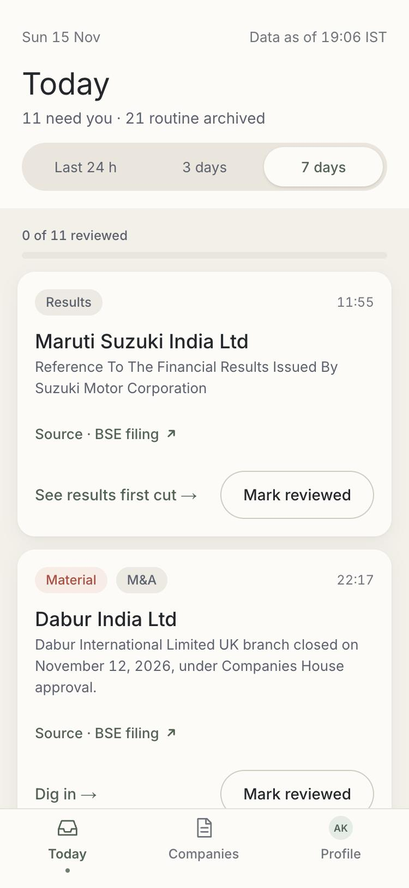
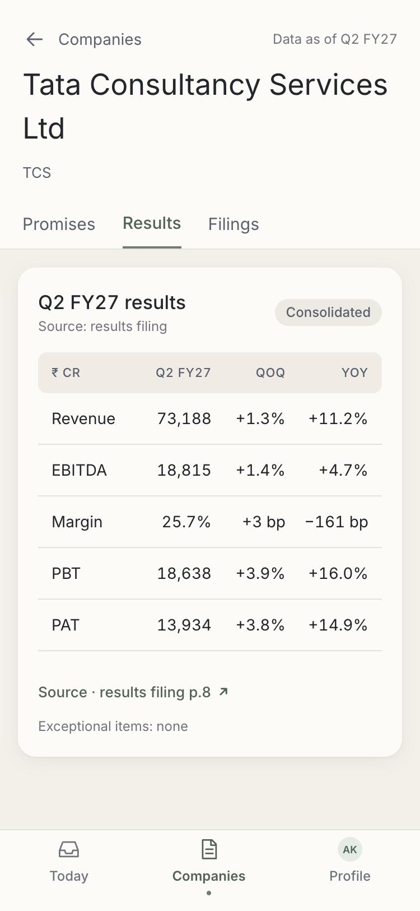
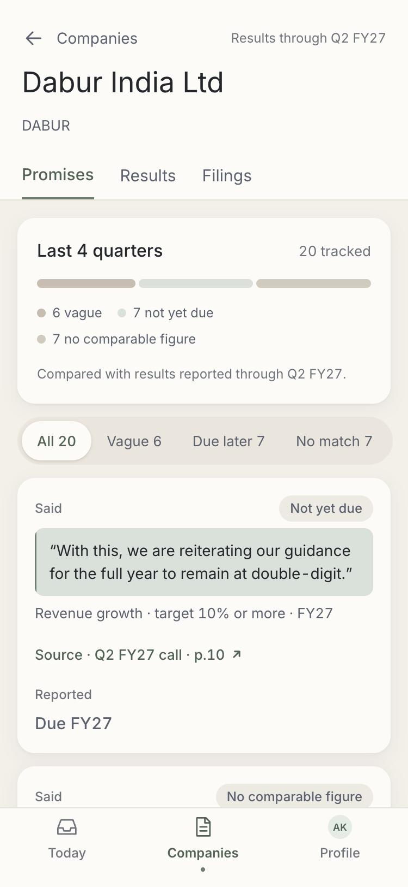
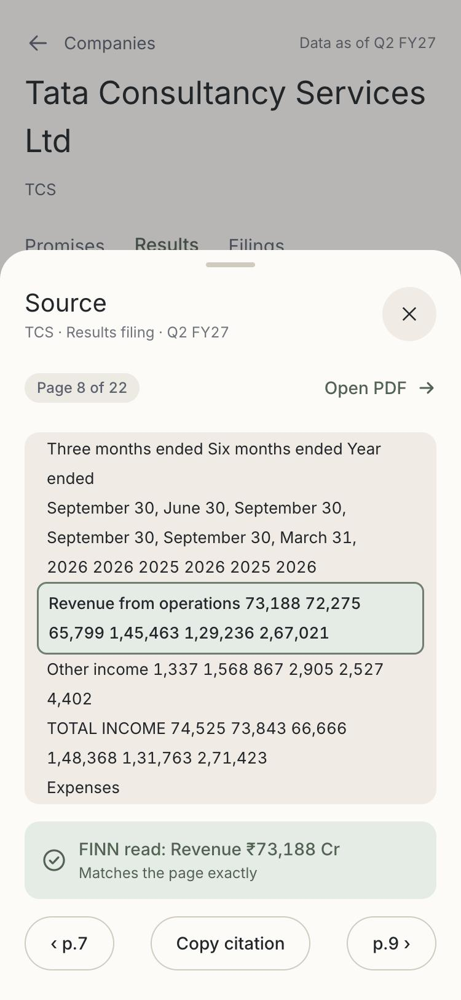
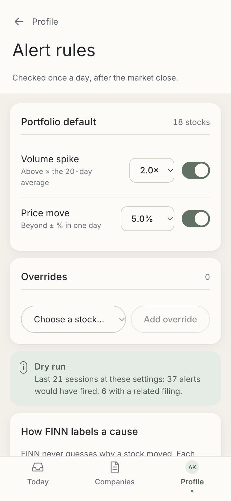
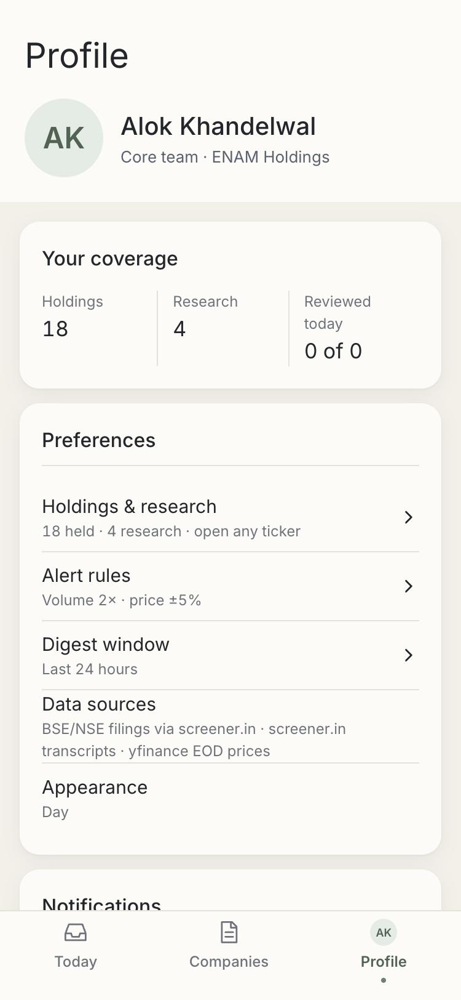
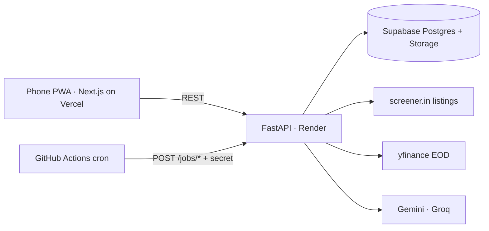

# FINN

**A mobile-first AI investor agent that filters filings, prices and results down to the few things that matter. Evidence, not verdicts.**

## Live demo

**https://finn-ruddy.vercel.app** — open it on a phone and "Add to Home Screen".

**Android app (APK):** https://github.com/sahityaiitd-ml/finn/releases/download/android-latest/finn.apk — open the link on an Android phone, tap the file, and allow "install unknown apps" once ([install notes](apps/android/README.md)). It opens the same live app inside a native shell. **iPhone:** open the web link, then Share → Add to Home Screen.

The API runs on a free Render instance that sleeps when idle: the **first request after a quiet spell can take about a minute** while it wakes. Give it a moment; later requests are fast.

## Try it in three steps

1. **Today.** Open **Today**, pick **7 days** (the data is from the weekend). Items that need you are ranked; routine paperwork sits in one drawer. Tap **Mark reviewed** until you reach **All caught up**.
2. **Prove a number.** **Companies → TCS → Results.** Tap **Source · results filing p.8**. A sheet opens at the cited page with the revenue line highlighted and "FINN read: Revenue ₹73,188 Cr — Matches the page exactly". Try **Dabur**: its year-ago column says **See PDF** because the scan was damaged; FINN shows nothing it cannot verify.
3. **What was promised.** **Companies → Dabur → Promises.** Every row is a verbatim quote with its page. Filter by status. Then type **TITAN** on Companies: no transcripts are stored, so FINN says so and gives the links. It never guesses.

Also: **Profile → Alert rules** (change a threshold; the dry run recomputes on a month of real prices).

## Screenshots

<p>



</p>
<p>



</p>

## What it does

- **Ranked filings digest (push).** 17 announcement categories, rules first (all 90 live filings were classified by rules; the small model is only for leftovers and short summaries). A hard **never-collapse floor** keeps results, board outcomes, M&A, auditor or KMP change, credit rating, pledge, litigation and fund-raise on screen. When unsure, it shows the item. Materiality is a Python score, never a model output.
- **Results first cut (push).** Parses SEBI Schedule III PDFs into Revenue, EBITDA, PBT and PAT with QoQ and YoY. Python derives EBITDA and every percentage. **Three identity checks gate every column**; a failing column shows "See PDF". It caught a scanned page whose PBT read `31.658` instead of 31,658, which would have been a 1000× error.
- **Promised vs delivered (pull).** Management guidance from the last four calls, each quote verified against its page (fuzzy match ≥ 90, or dropped), with a status set in Python: Delivered / Missed / Partly / Vague / Not yet due / No comparable figure. No score, ever.
- **End-of-day alerts.** One batched yfinance call after the close: volume above 2× the 20-day average, or price beyond ±5%, with per-stock overrides. The cause label is exactly "No related filing found" or "Related filing found, cause unconfirmed". A price move is never coloured.

Every number and quote links to its source page.

## Architecture



| Task | Route |
|---|---|
| Filing classification | rules/regex (90 of 90 live filings) |
| Leftover classification, ≤ 25-word summaries | Groq `gpt-oss-20b` |
| Guidance extraction | Gemini `gemini-3.5-flash` (Groq `gpt-oss-120b` fallback) |
| Results lines, EBITDA, margins, changes, every status | Python only |
| Scanned pages | not read: shown as "See PDF" |

Details: [docs/architecture.md](docs/architecture.md), decisions in [docs/decisions/](docs/decisions/).

## Cost and caching

- **Every model call is cached forever** by `sha256(model + prompt_version + input)`. The whole build made **52 distinct model calls** (6 small, 46 extraction); repeat views cost nothing.
- A promise ledger is **4 calls per ticker** (the last four calls, ~6 pages each, about 25,000 input tokens in total). Ledgers are keyed by symbol, transcript hashes, results hashes, prompt and rules version, so they rebuild only when an input changes.
- **Page picking** sends only the six most forward-looking pages of a 20–35 page transcript.
- Classification is rules-first: no model was needed to classify any of the 90 filings. The small model only wrote ≤ 25-word summaries for the 5 whose headlines say little.
- Everything runs on free tiers (Vercel, Render, Supabase, GitHub Actions, Groq, Gemini).

## Run locally

```bash
cp .env.example .env            # fill in Supabase, Groq, Gemini keys
cd services/api && uv sync && uv run python -m jobs.load_demo     # demo data
uv run fastapi dev app/main.py                                     # API on :8000
cd apps/web && pnpm install && pnpm dev                            # web on :3000
```

Tests: `cd services/api && uv run pytest` (147) · `cd apps/web && pnpm test` (8).

## Deploy

[docs/deploy.md](docs/deploy.md): Supabase → Render → Vercel → GitHub Actions secrets.

## Decisions and trade-offs

- **The model extracts; Python decides.** A filter that labels a material filing routine is the real risk, so the floor, the score and every status are code. The model once labelled a compliance-officer change "unclassified"; rules and a "when unsure, show it" default now catch that class of mistake.
- **A failed read is an error, never "no guidance".** Groq's free tier (8,000 tokens/min) rate-limited the large model and an early version quietly reported zero promises. Calls now retry, and a partly failed job is never cached as done. Extraction moved to Gemini.
- **Refuse rather than guess.** Identity checks per column; unit detection (crore/lakh/million) with "unclear → not compared"; a metric label must be supported by the words near the quote.
- **BSE and NSE block scripted access** (403), and we do not work around bot protection. Listings come from screener.in (its `robots.txt` allows company pages); PDFs come from a hand-downloaded demo set. Tickers outside the demo set show the source links instead of numbers.
- **No vector database.** Pages are the citation unit; Postgres full-text over page rows keeps provenance exact.
- **One shared demo portfolio, no sign-in.** The prototype is for review, not multi-user use.

## Deliberately left out

Event and governance timeline, new-executive bio, thesis tracking, annual-report year-on-year diff, notes-to-accounts red flags, real-time push, live call transcription, and credibility scores (by design, never). Also not built: banks and NBFCs ("format not supported"), the NSE fetch, MNLI entailment checks, and Tesseract OCR.

## Next steps

- Read scanned statements with Gemini vision, gated by the same identity checks (Dixon and Maruti are scans today).
- Fetch PDFs through a sanctioned channel (company IR sites, or an exchange data licence) so any ticker works end to end.
- Wider guidance matching: segments and volumes from the call itself, constant-currency growth.
- Per-user portfolios, notifications, and a sign-in.
- Pick demo tickers whose guidance is numeric and aggregate (revenue growth, margin bands) to show scored rows.

## AI build history

Built with Claude Code. The decisions, the dead ends and what each milestone changed are in [docs/build-log.md](docs/build-log.md). The coding-agent conversation is attached to the covering email ([docs/covering-email.md](docs/covering-email.md)).
