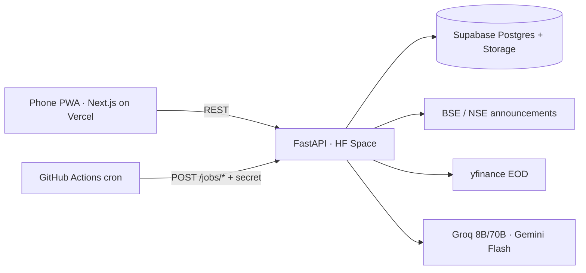

# Architecture

## Model routing
| Task | Route |
|---|---|
| Filing classification (~80%) | rules/regex |
| Leftover classification, short summaries | Groq 8B |
| Guidance extraction | Groq 70B |
| Scanned pages, odd-metric mapping | Gemini Flash (response_schema) |
| Results lines | rules only |

Every model call is cached forever by `sha256(model + prompt_version + input)`.

## Cost
Free tiers only: Vercel, HF Spaces (CPU), Supabase, GitHub Actions, Groq, Gemini free quotas. Estimate to be filled in M6.
