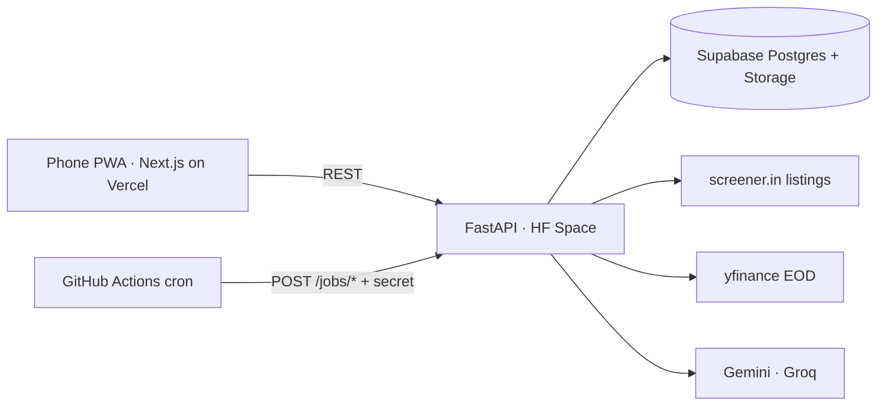

# Architecture

## Layout
`apps/web` (Next.js App Router, TypeScript strict, Tailwind with tokens in `styles/tokens.css`) ·
`services/api` (FastAPI: `app/` HTTP, `jobs/` batch work, `extract/` parsers and model calls,
`rules/` classifier and scoring) · `supabase/migrations` · `data/demo` (PDFs, company seed, snapshot).

## Model routing
| Task | Route | Why |
|---|---|---|
| Filing classification | rules/regex | 90 of 90 live filings; free and auditable |
| Leftover classification, summaries (≤ 25 words) | Groq `openai/gpt-oss-20b` | small, cheap; output validated in Python |
| Guidance extraction | Gemini `gemini-3.5-flash`, Groq `gpt-oss-120b` fallback | big context, high free limits; Groq's free tier is 8,000 tokens/min |
| Results lines, EBITDA, margins, changes, statuses | Python | the model never touches a number that is shown |

Every call is cached forever by `sha256(model + prompt_version + input)`.

## Trust layer
1. Quotes: rapidfuzz ≥ 90 against the cited page, or dropped.
2. Numbers the model returns must appear in its quote.
3. Metric labels must be supported by the words around the quote.
4. Results: three identity checks per column; unit detected or the figure is not compared.
5. Every status, score and percentage is computed in Python (`extract/promises.py`, `rules/`).

## Data flow
- **Filings:** `POST /jobs/fetch-filings` (cron, every 30 min on market days) reads each holding's screener.in page, stores announcements, then classifies them.
- **Prices and alerts:** `POST /jobs/eod` (16:30 IST) makes one batched yfinance call, stores three months of prices, applies the rules, and attaches one of two cause labels.
- **Results:** `jobs/parse_results` parses stored PDFs. **Promises:** `POST /promises/{symbol}` starts a job; `GET /jobs/{id}` is polled.
- **Citations:** `GET /docs/{sha256}/page/{n}?q=` returns the page, a fuzzy-located highlight and a signed link to the original PDF.

## Cost
Free tiers only. A promise ledger is about 25,000 input tokens per ticker (four calls). The whole build made 52 distinct model calls, 90 of 90 filings were classified without a model (the small model only summarised 5 vague headlines), and repeat views are served from the cache.
